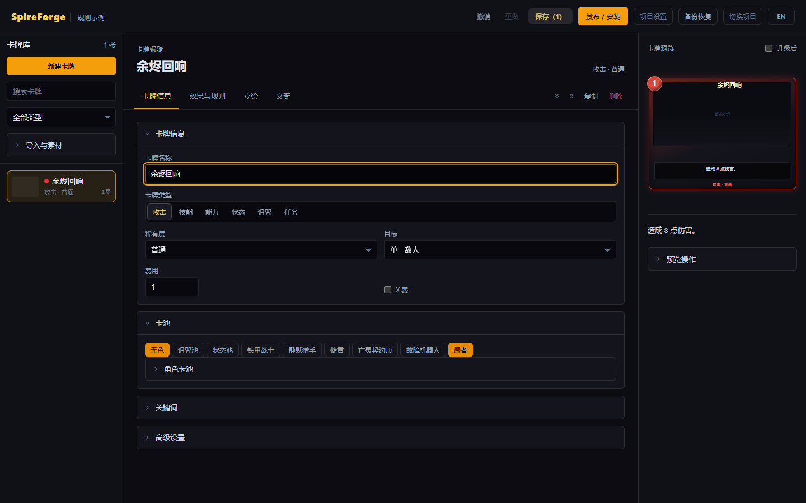

# SpireForge 尖塔锻炉

《杀戮尖塔 2》卡牌编辑器。可视化设计卡牌、复杂规则与自定义状态，预览后打包安装或发布到 Steam 创意工坊。

中文 | [English](README_EN.md)

[下载 Windows 版](https://github.com/FanerJian/SpireForge/releases/latest) · [使用指南](docs/RULES-GUIDE.md) · [更新记录](CHANGELOG.md)



## 使用

1. 下载 `SpireForge-0.4.4-win64.zip`，完整解压，运行 `editor.exe`。需要 Windows 10/11 和 WebView2。
2. 选择游戏目录。关闭游戏后，编辑器会安装随附的 Runtime 0.2.3。
3. 新建或打开卡包，编辑卡牌，再通过「发布 / 安装」安装到游戏。

当前适配目标为 **v0.113.0 public-beta**，默认卡池包含**愚者**。已完成接口检查、真实游戏程序集编译和自动回归；游戏内战斗与新模式继续按[适配记录](docs/GAME-COMPATIBILITY-0.113.0.md)验收。

## 功能

- 卡牌编辑、立绘与实时预览，中英双语。
- 条件、循环、随机、动态数值、计数器、自定义状态和选牌操作。
- 模板与结构导航，复杂规则可在专注模式下编辑。
- 导入原版和 Mod 内容，支持官方及第三方角色卡池。
- 卡包安装、备份恢复、Steam 工坊发布。

## 开发

```powershell
cd editor
pnpm install --frozen-lockfile
pnpm tauri dev
```

需要 Node.js、pnpm 和 Rust；Runtime 构建另需 .NET 9 与本机游戏程序集。详见[构建说明](docs/BUILD.md)、[架构](docs/ARCHITECTURE.md)和[文档索引](docs/INDEX.md)。

```powershell
node tools/verify.mjs
```

发布检查与本次修复见[安全审查](docs/SECURITY-REVIEW-0.4.3.md)。

## 许可

项目代码采用 [MIT](LICENSE)。Spire Codex 派生目录与图标遵循 PolyForm Noncommercial 1.0.0；完整来源与分发说明见[第三方声明](THIRD-PARTY-NOTICES.md)。

SpireForge 是社区工具。游戏名称、文本与资产归 Mega Crit 所有。
