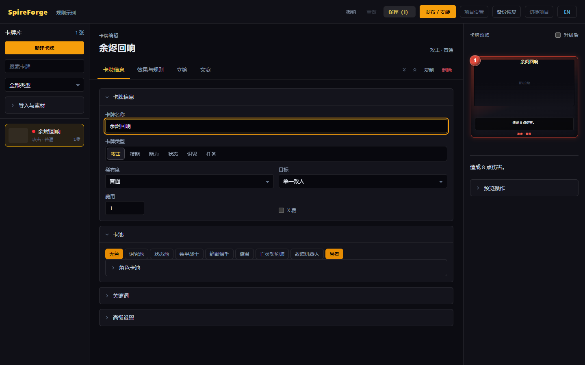

# SpireForge

A card editor for Slay the Spire 2. Design cards, rules and custom statuses, preview them, then install a pack or publish it to Steam Workshop.

[中文](README.md) | English

[Download for Windows](https://github.com/FanerJian/SpireForge/releases/latest) · [Rule guide](docs/RULES-GUIDE.md) · [Changelog](CHANGELOG.md)



## Getting started

1. Download and extract `SpireForge-0.4.4-win64.zip`, then run `editor.exe`. Requires Windows 10/11 and WebView2.
2. Select your game folder. Close the game while the editor installs the bundled Runtime 0.2.3.
3. Create or open a pack, edit cards, and use **Publish / Install**.

The current compatibility target is **v0.113.0 public-beta**, including **The Fool** in the default pools. API metadata checks, compilation against installed game assemblies and automated regressions have passed. In-game combat and new-mode verification remain follow-up work; see the [compatibility record](docs/GAME-COMPATIBILITY-0.113.0.md).

## Features

- Card editing, artwork, live preview and Chinese/English localization.
- Conditions, loops, random branches, dynamic values, counters, custom statuses and card selection.
- Templates, structural navigation and a focused rule workspace.
- Base-game and Mod content import, official and third-party character pools.
- Pack installation, backups, recovery and Steam Workshop publishing.

## Development

```powershell
cd editor
pnpm install --frozen-lockfile
pnpm tauri dev
```

Requires Node.js, pnpm and Rust. Building the Runtime also requires .NET 9 and local game assemblies. See [build instructions](docs/BUILD.md), [architecture](docs/ARCHITECTURE.md), the [documentation index](docs/INDEX.md), and the [release security review](docs/SECURITY-REVIEW-0.4.3.md).

```powershell
node tools/verify.mjs
```

## License

Project code is licensed under [MIT](LICENSE). Spire Codex-derived catalogs and icons use PolyForm Noncommercial 1.0.0. See [third-party notices](THIRD-PARTY-NOTICES.md) for sources and distribution details.

SpireForge is a community tool. Game names, text and assets belong to Mega Crit.
